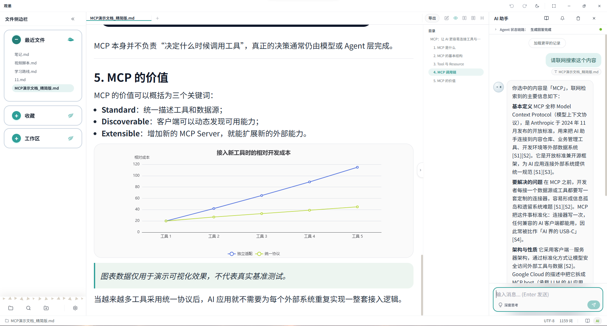
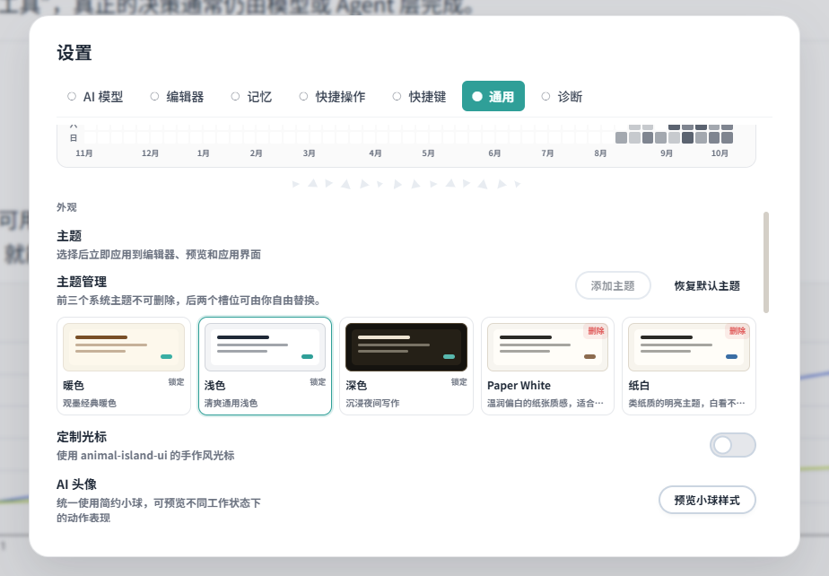
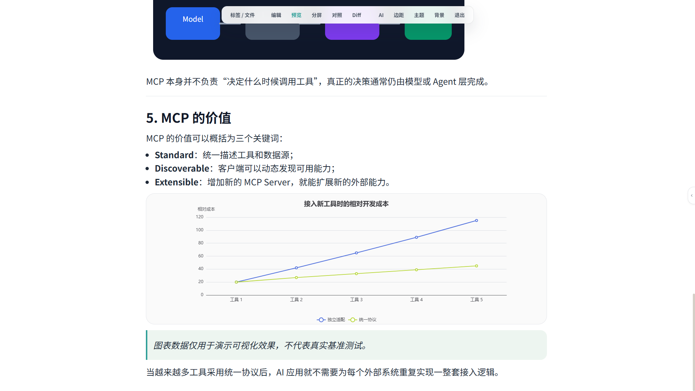
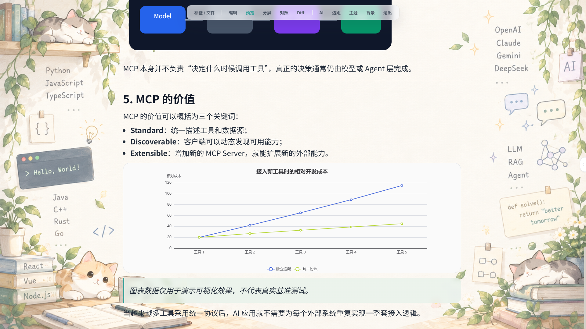
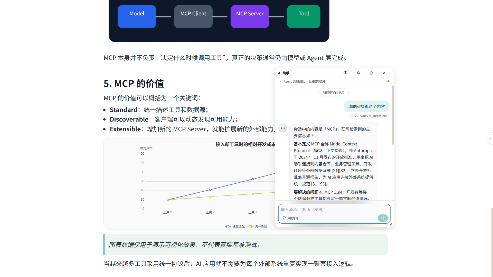
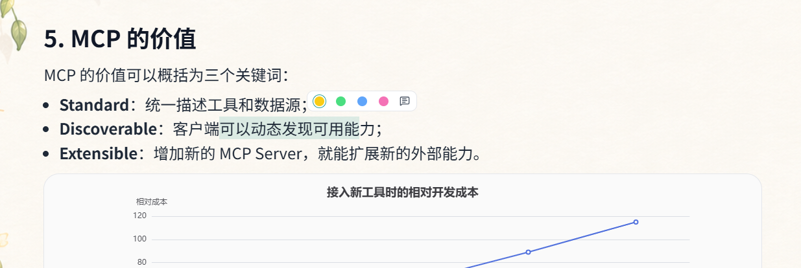
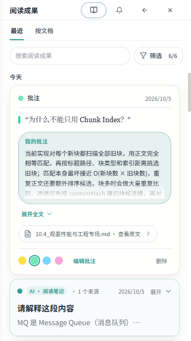

<p align="center">
  
</p>

<h1 align="center">GuanMo · 观墨</h1>

<p align="center">
  <strong>A local-first Markdown workspace for long-form reading, in-place editing, and AI-assisted understanding</strong>
</p>

<p align="center">
  <strong>English</strong> · <a href="README.zh-CN.md">简体中文</a>
</p>

<p align="center">
  
  
  
  
  
</p>

## Download and Try Online

| Platform | Get started |
| --- | --- |
| Windows | [Download the latest release](https://github.com/we-used-to-be/Guanmo-open/releases/latest): NSIS (`.exe`), WiX (`.msi`), and portable ZIP |
| Web | [Try online](https://we-used-to-be.github.io/Guanmo-page/): Markdown editing, preview, and basic AI chat; see the limitations below |
| macOS | No prebuilt release is currently available. See [Development](#development) to build and test it yourself. |

[Get GuanMo from the Microsoft Store](https://apps.microsoft.com/detail/9N2C2C3ZS467?mode=direct&cid=DevShareMCLPCS)

Microsoft Store updates may arrive later than GitHub releases. The online demo may also lag behind the repository.

## Screenshots

<p align="center">
  
</p>

<table align="center">
  <tr>
    <td align="center"><b>Themes</b></td>
    <td align="center"><b>Fullscreen reading</b></td>
  </tr>
  <tr>
    <td width="50%"></td>
    <td width="50%"></td>
  </tr>
</table>

<details>
<summary>More screenshots: reading backgrounds, floating AI, annotations, and reading notes</summary>

### Reading backgrounds



### Floating AI assistant



### Highlights and annotations



### Reading notes



</details>

## Core Features

- **Read long documents**: viewport-based preview rendering, outline navigation, reading position restoration, and synchronized scrolling for technical documentation, study materials, and book notes.
- **Stay immersed**: hide the title bar and sidebars in fullscreen, adjust themes, text margins, and reading backgrounds, and keep the AI assistant nearby in a draggable floating window.
- **Edit in place**: enable in-preview source editing, then `Alt + click` a Markdown block to edit its source directly without searching through the full document.
- **Highlight, annotate, and revisit**: collect personal annotations alongside AI summaries, explanations, and reading notes. Jump from manual highlights and annotations back to the source. These records stay on your device, separate from the Markdown file.
- **Ask with context**: add selections, files, or folders to the current request and ask questions with nearby text as context. AI changes to source documents require authorization for the current request and your confirmation.
- **Search your knowledge base with RAG**: split Markdown along semantic boundaries and retrieve relevant passages and sources from indexed documents using vector and keyword search. Configure chat and embedding models separately, with compatible APIs and local services such as Ollama.

These features primarily describe the desktop app. Remote AI and embedding services receive the relevant context or text; processing is not necessarily offline.

## More at a Glance

| Area | Features |
| --- | --- |
| Editing and comparison | CodeMirror 6, multiple tabs, find and replace, autosave, session restoration; editor, preview, split, two-document, and diff views |
| Markdown rendering | GFM, syntax highlighting, task lists, KaTeX math, Mermaid diagrams, and ECharts charts |
| Images and export | Select, drag, or paste images with relative asset paths; export HTML or save as PDF through the print dialog |
| Files and workspaces | Multiple workspaces, recent files, favorites, file associations, and drag-and-drop opening of `.md` files |
| AI assistance | Streaming responses, an Agent execution timeline, web search, custom response styles, and saved answers |
| Personalization and data | Built-in and custom themes, font and display settings, desktop app data backup and import |

**Web limitations**: basic AI chat and web search depend on the service allowing cross-origin requests (CORS). Browsers with directory access support can manage local Markdown files; other browsers use single-file selection and download-based saving. The web app does not provide a knowledge base, embeddings, persistent annotations or reading notes, or persistent chat history. Files, tabs, and chats are not restored after a page reload.

See the **[User Guide](docs/USER_GUIDE.md)** for instructions, shortcuts, and troubleshooting, and the [AI Guide](docs/AI_ROUTING_GUIDE.md) for selection-based questions, knowledge base use, and web search. Both guides are currently in Chinese.

## Getting Started and Development

### Start reading

Install the desktop app and open a local `.md` file to read or edit it. To use AI, configure a compatible service endpoint, model, and API key in Settings. Add a selection or file to the AI context before asking questions about it.

### Development

- [Node.js](https://nodejs.org/) ≥ 22; desktop development also requires [Rust stable](https://www.rust-lang.org/).
- On Windows, install [Microsoft C++ Build Tools](https://visualstudio.microsoft.com/visual-cpp-build-tools/) with the “Desktop development with C++” workload, plus [WebView2](https://developer.microsoft.com/microsoft-edge/webview2/). See the [Tauri prerequisites](https://v2.tauri.app/start/prerequisites/) for other system dependencies.
- The Tauri CLI is included in the project’s development dependencies.

```bash
git clone https://github.com/we-used-to-be/Guanmo-open.git
cd Guanmo-open
npm ci

# Create local configuration with secret identifiers only, never real API keys
cp .env.example .env

# Desktop development
npm run tauri dev

# Web development
npm run dev
```

In Windows PowerShell, you can use `Copy-Item .env.example .env` instead of `cp`.

| Task | Command |
| --- | --- |
| Web build, including type and bundle size checks | `npm run build` |
| Desktop frontend build, including type and bundle size checks | `npm run build:desktop` |
| Full desktop app and installers | `npm run tauri build` |
| Type checking / linting | `npm run typecheck` / `npm run lint` |
| Run unit and component tests once | `npm test` |
| Agent parser / Markdown math tests | `npm run test:agent-parser` / `npm run test:markdown-math` |
| Asset path checks | `npm run check:paths` |

Issues and pull requests are welcome. Include reproduction steps or relevant verification results, and keep credentials, user data, and build artifacts out of commits. For release maintenance, follow the [release preflight](docs/release-preflight.md) and [push safety rules](docs/push-safety.md) (in Chinese).

## Tech Stack

| Layer | Technology |
| --- | --- |
| Desktop and data | Tauri 2, Rust, SQLite (Tauri SQL plugin + SQLx transactions) |
| Frontend | React 18, TypeScript 5.7, Vite 6, Zustand 5 |
| Editor | CodeMirror 6 |
| UI and styling | Tailwind CSS 3.4, custom design tokens, vendored Animal Island UI components |
| Markdown | react-markdown, remark-gfm, rehype-highlight, KaTeX |
| Diagrams and charts | Mermaid, ECharts |

## Security, Privacy, and License

### Security and privacy

- No API keys are bundled. Enter your own keys in the app’s settings. The Windows desktop app encrypts them locally with DPAPI, and regular backups exclude them.
- `.env` contains identifiers for local secret storage, not real API keys. Do not commit `.env`, databases, or chat records. See [`.env.example`](.env.example).
- Markdown files stay local, and desktop app data is stored in local SQLite. Remote AI, embedding, and web search services receive the data needed to fulfill your requests. See the [Privacy Policy](PRIVACY.md) (in Chinese).
- Web API keys can stay in page memory or be saved locally in the browser at your choice. Plaintext storage carries risks; encrypted storage requires a local password. See [web key storage](docs/USER_GUIDE.md#web-keys) (in Chinese).
- The software is provided “AS IS.” Back up important data and independently review AI-generated or modified content before use. See the [Disclaimer](DISCLAIMER.md) (in Chinese).

<a id="license-and-trademark"></a>

### License and trademarks

GuanMo source code is licensed under the [MIT License](LICENSE). Third-party code and assets remain subject to their respective licenses and terms. The MIT License does not grant permission to use the GuanMo name, logo, or other brand identifiers. Derivative projects must not imply affiliation with, authorization from, sponsorship by, or endorsement by the official GuanMo project.

The project vendors an [animal-island-ui](https://github.com/guokaigdg/animal-island-ui) component snapshot and retains its MIT license. The upstream README’s non-commercial-use notes differ from the MIT LICENSE; review the upstream terms before commercial distribution. GuanMo is not an official Nintendo product and has no association, authorization, or cooperation with Nintendo Co., Ltd. See [Third-party Notices](THIRD_PARTY_NOTICES.md) for full attribution and licensing information.
