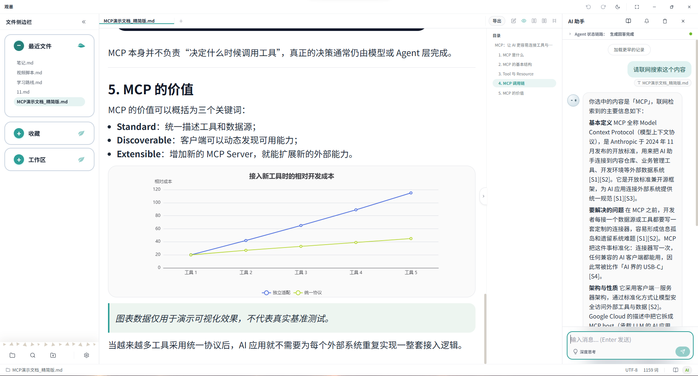
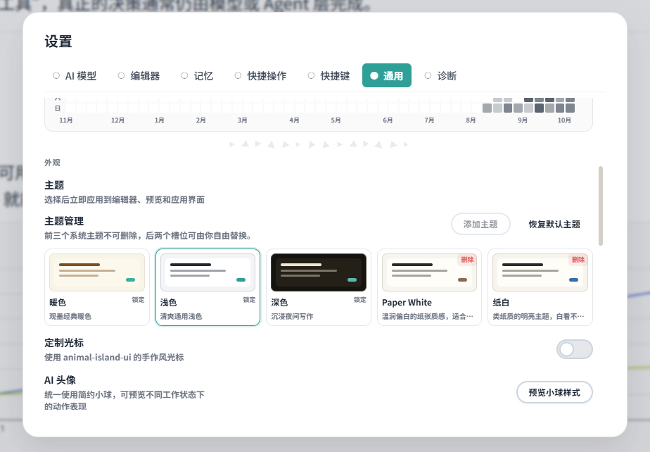
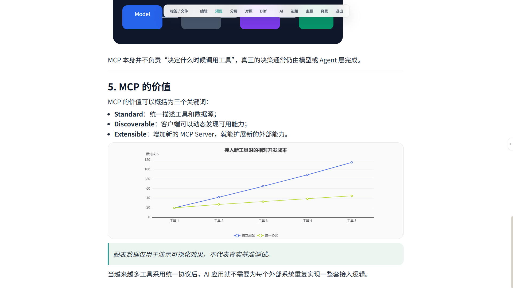
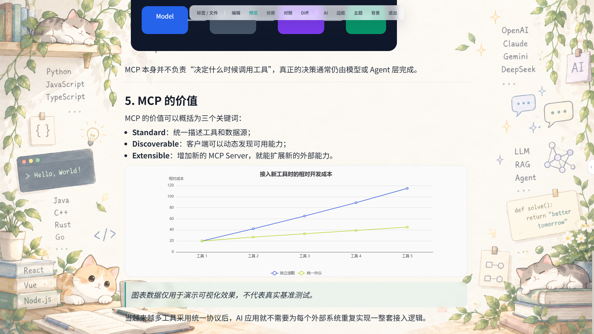
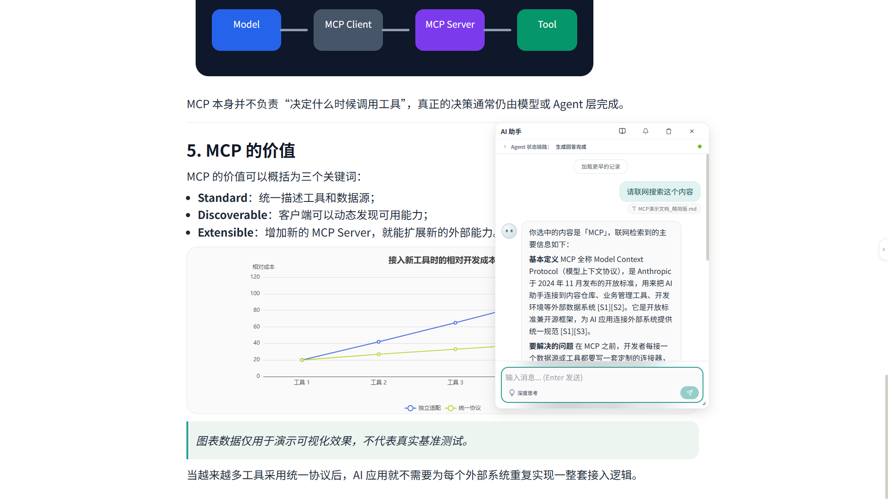
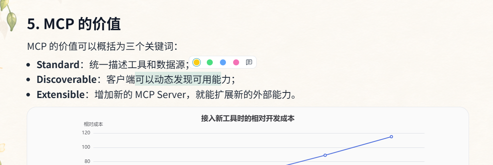
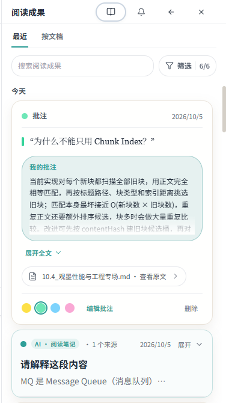

<p align="center">
  
</p>

<h1 align="center">观墨 · GuanMo</h1>

<p align="center">
  <strong>专注长文档阅读、原地编辑与 AI 辅助理解的本地优先 Markdown 工作空间</strong>
</p>

<p align="center">
  
  
  
  
  
</p>

<p align="center">
  <a href="README.md">English</a> · <strong>简体中文</strong>
</p>

## 下载与在线体验

| 平台 | 入口与说明 |
| --- | --- |
| Windows | [下载最新版本](https://github.com/we-used-to-be/Guanmo-open/releases/latest)：提供 NSIS（`.exe`）、WiX（`.msi`）安装包及便携 ZIP |
| 网页版 | [在线体验](https://we-used-to-be.github.io/Guanmo-page/)：支持 Markdown 编辑、预览与基础 AI 对话，具体限制见下方说明 |
| macOS | 暂不提供预编译版本，可参考[开发构建](#开发构建)自行打包测试 |

<a href="https://apps.microsoft.com/detail/9N2C2C3ZS467?mode=direct&cid=DevShareMCLPCS">
  
</a>

微软商店版本更新可能晚于 GitHub；在线体验部署版本也可能与仓库不同步。

## 软件截图

<p align="center">
  
</p>

<table align="center">
  <tr>
    <td align="center"><b>主题管理</b></td>
    <td align="center"><b>全屏阅读</b></td>
  </tr>
  <tr>
    <td width="50%"></td>
    <td width="50%"></td>
  </tr>
</table>

<details>
<summary>更多截图：阅读背景、AI 小窗、高亮批注与阅读成果</summary>

### 阅读背景



### 全屏 AI 小窗



### 高亮与批注



### 阅读成果



</details>

## 核心特色

- **长文档阅读**：预览支持按可视区域渲染，配合目录导航、阅读位置恢复与同步滚动，适合技术文档、学习资料和书籍笔记。
- **沉浸式体验**：全屏隐藏标题栏与侧边栏，可调整主题、正文边距和阅读背景；AI 助手以可拖动的小窗伴随阅读。
- **预览内原地编辑**：开启“预览内源码编辑”后，按 `Alt + 左键` 编辑对应 Markdown 块，无需切回全文源码查找。
- **高亮、批注与阅读成果**：标记重点、记录想法，集中回看个人批注与 AI 摘要、解读和阅读笔记，并从手动标记返回原文。记录独立于 Markdown 正文保存在本机。
- **AI 上下文理解**：将选区、文件或文件夹加入本轮上下文，结合选区附近内容提问；AI 修改原文须经本轮授权与用户确认。
- **本地知识库与 RAG**：按 Markdown 语义结构分块，结合向量与关键词检索已入库文档，为回答提供相关片段与来源。对话与 Embedding 模型可独立配置，支持兼容接口及 Ollama 等本地服务。

以上以桌面版为主；使用远程 AI 或 Embedding 时，相关上下文或文本会发送到你配置的服务，并非全部离线处理。

## 其他功能概览

| 方向 | 功能 |
| --- | --- |
| 编辑与对照 | CodeMirror 6、多标签页、搜索替换、自动保存、会话恢复；编辑、预览、并排、双文档与 Diff 视图 |
| Markdown 渲染 | GFM、代码高亮、任务列表、KaTeX 公式、Mermaid 与 ECharts 图表 |
| 图片与导出 | 选择、拖拽或粘贴图片，生成相对资源路径；导出 HTML，通过打印对话框保存 PDF |
| 文件与工作区 | 多工作区、最近文件、收藏夹，以及系统关联和拖放打开 `.md` 文件 |
| AI 辅助 | 流式回答、Agent 执行时间线、联网搜索、自定义回复风格与回答保存 |
| 个性化与数据 | 内置及自定义主题、字体与显示设置、桌面应用数据备份与导入 |

**网页版边界**：提供基础 AI 对话和联网搜索，受服务端 CORS 限制；支持目录授权的浏览器可管理本地 Markdown 文件，其他浏览器使用单文件选择与下载保存。网页版不提供知识库、Embedding、持久批注与阅读成果或持久聊天历史；文件、标签页与聊天不跨刷新恢复。

操作步骤、快捷键和常见问题见 **[观墨使用手册](docs/USER_GUIDE.md)**；选区提问、知识库与联网搜索示例见 [AI 使用指南](docs/AI_ROUTING_GUIDE.md)。

## 快速开始与开发构建

### 开始使用

安装桌面版后，打开本地 `.md` 文件即可阅读与编辑。使用 AI 前，在设置中配置兼容的模型服务地址、模型与 API Key；围绕原文提问时，先将选区或文件加入 AI 上下文。

### 开发构建

- [Node.js](https://nodejs.org/) ≥ 22；桌面开发另需 [Rust stable](https://www.rust-lang.org/)。
- Windows 还需 [Microsoft C++ Build Tools](https://visualstudio.microsoft.com/visual-cpp-build-tools/)（“使用 C++ 的桌面开发”）与 [WebView2](https://developer.microsoft.com/microsoft-edge/webview2/)。其他系统依赖见 [Tauri 前置要求](https://v2.tauri.app/zh-cn/start/prerequisites/)。
- Tauri CLI 随项目开发依赖安装。

```bash
git clone https://github.com/we-used-to-be/Guanmo-open.git
cd Guanmo-open
npm ci

# 创建本机配置，仅包含密钥标识名，不填写真实 API Key
cp .env.example .env

# 桌面开发
npm run tauri dev

# 网页开发
npm run dev
```

Windows PowerShell 可用 `Copy-Item .env.example .env` 代替 `cp`。

| 目标 | 命令 |
| --- | --- |
| 网页构建（含类型与体积检查） | `npm run build` |
| 桌面前端构建（含类型与体积检查） | `npm run build:desktop` |
| 完整桌面应用与安装包 | `npm run tauri build` |
| 类型检查 / Lint | `npm run typecheck` / `npm run lint` |
| 单次单元与组件测试 | `npm test` |
| Agent 解析器 / 数学公式测试 | `npm run test:agent-parser` / `npm run test:markdown-math` |
| 资源路径检查 | `npm run check:paths` |

欢迎提交 Issue 和 Pull Request，请附复现步骤或相关验证结果，避免提交密钥、用户数据与构建产物。发布维护请遵循[发布检查流程](docs/release-preflight.md)与[推送安全规则](docs/push-safety.md)。

## 技术栈

| 层级 | 技术 |
| --- | --- |
| 桌面与数据 | Tauri 2、Rust、SQLite（Tauri SQL 插件 + SQLx 事务） |
| 前端 | React 18、TypeScript 5.7、Vite 6、Zustand 5 |
| 编辑器 | CodeMirror 6 |
| 界面与样式 | Tailwind CSS 3.4、自定义设计令牌、Animal Island UI 组件快照 |
| Markdown | react-markdown、remark-gfm、rehype-highlight、KaTeX |
| 图表 | Mermaid、ECharts |

## 安全、隐私与许可证

### 安全与隐私

- 本项目不内置 API Key；请通过应用设置填写。Windows 桌面版使用 DPAPI 加密后保存在本机，常规备份不含密钥。
- `.env` 仅配置本机密钥存储的标识名，不应填写真实 API Key；不要提交 `.env`、数据库或聊天记录。配置格式见 [`.env.example`](.env.example)。
- Markdown 文件保存在本地，桌面应用数据使用本机 SQLite；使用远程 AI、Embedding 或联网搜索时，完成请求所需的数据会发送到你选择的服务商。详见[隐私政策](PRIVACY.md)。
- 网页版密钥可仅存于页面内存，或按用户选择保存在浏览器本地；明文保存存在风险，加密保存需设置本地密码。详见[网页密钥说明](docs/USER_GUIDE.md#web-keys)。
- 软件按“现状”（AS IS）提供。请备份重要数据，并在使用前核查 AI 生成或修改的内容；详见[免责声明](DISCLAIMER.md)。

<a id="license-and-trademark"></a>

### 许可证与品牌声明

观墨源代码采用 [MIT License](LICENSE)；第三方代码与资源仍受各自许可证和条款约束。MIT 许可证不授予 GuanMo 名称、Logo 或其他品牌标识的使用权，衍生项目不得暗示与官方关联或获得授权、赞助或背书。

项目保留了 [animal-island-ui](https://github.com/guokaigdg/animal-island-ui) 组件快照及其 MIT 许可证。上游 README 的非商业说明与 MIT LICENSE 存在表述差异，商业分发前请自行核对上游条款。观墨不是 Nintendo 官方产品，与 Nintendo Co., Ltd. 无关联、授权或合作关系。完整归属与许可说明见 [第三方声明](THIRD_PARTY_NOTICES.md)。
