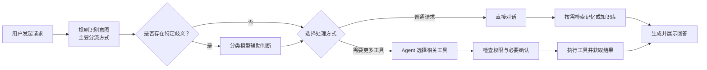
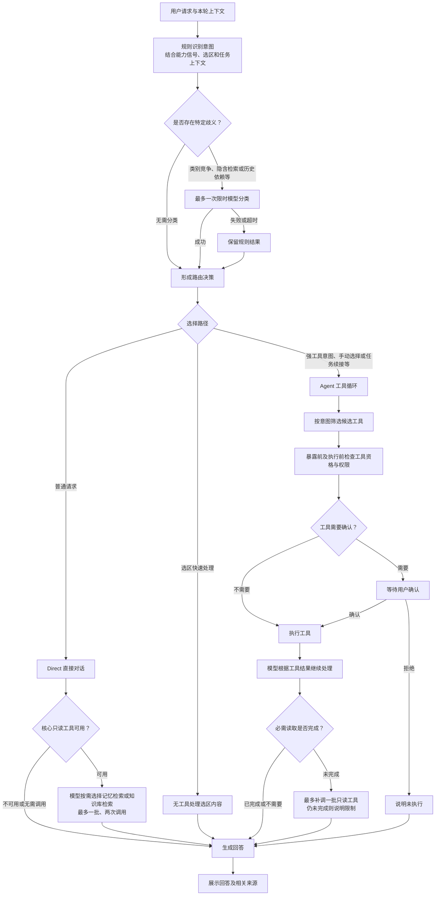
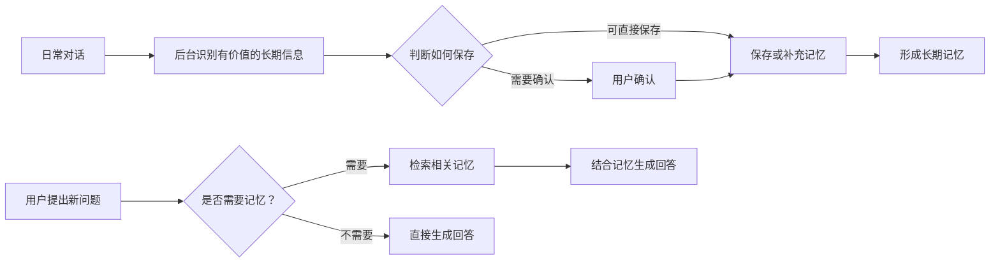
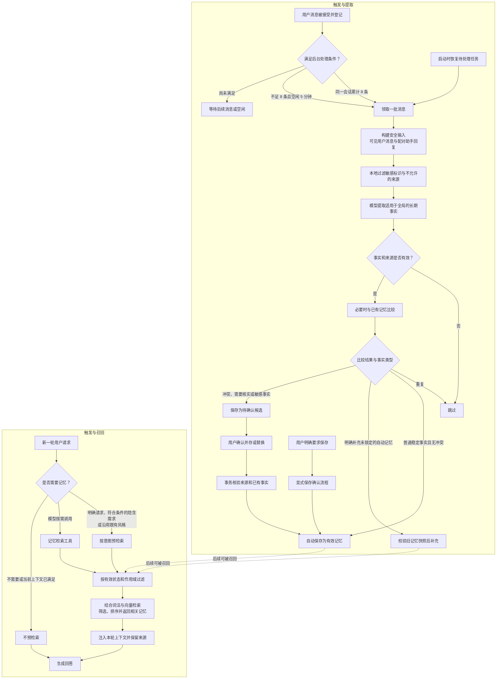

# 观墨的工作原理

本文介绍观墨桌面端的 AI 请求处理和长期记忆机制。流程图用于帮助理解主要路径；具体能力取决于配置、可用性和当前请求的授权范围。

## AI 请求与 Agent

### 简化流程

普通对话的记忆检索和知识库检索默认可用，由模型按需调用；具体还受设置和工具资格限制。分类模型可在同一连接下单独配置，不一定是轻模型。

### 详细流程

- 规则结合强信号、必需能力、上下文和不同能力的弱信号判断；单一弱信号通常不足以进入 Agent。
- 分类只在特定歧义下辅助选择，不执行工具，也不授予权限；即使无需进入工具循环，仍可能独立触发记忆预检索。
- Agent 按需求使用记忆、知识库、阅读成果、选区、文件、联网及时间等工具；写入和调度操作遵循相应确认策略。
- 仅翻译本轮选区属于快速处理，只返回译文；明确要求替换原文时，按文档修改流程处理并等待确认。

## 长期记忆

### 简化流程

### 详细流程

- 自动提取在后台进行，不阻塞当前回答。输入不包含附件、文档、工具原始输出或隐藏内容；密码、密钥等敏感标识会在模型请求前拦截。
- 一般健康或财务事实以及需要处理冲突的事实进入候选，等待用户确认。自动补充仅针对符合条件、未锁定的自动记忆，并在写入时核验快照。
- 召回只注入有效且未被替代的记忆，项目记忆限定在当前工作区；向量不可用时保留词法检索。

实现与安全边界详见 [AI 与选区契约](agent-contracts/ai-selection.md)和 [RAG 与长期记忆契约](agent-contracts/rag-memory.md)。
